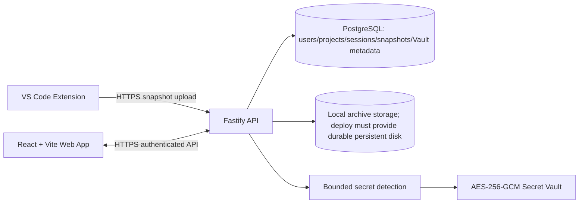
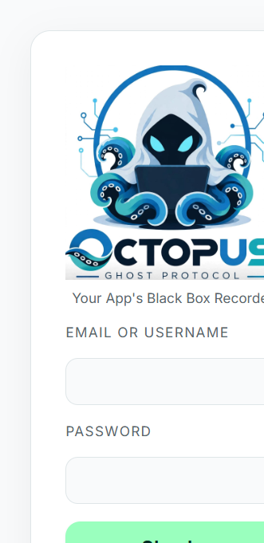
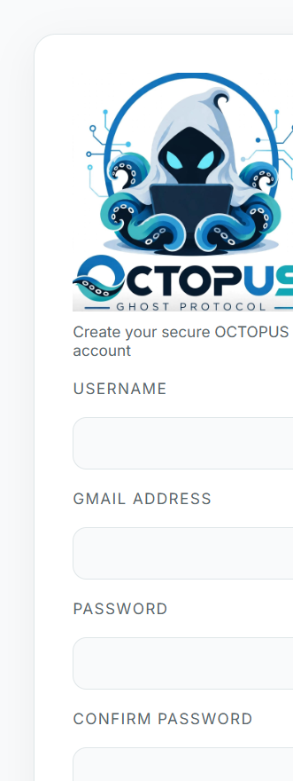

# OCTOPUS Ghost Protocol

## 1. Project Introduction

OCTOPUS Ghost Protocol helps developers preserve a complete, inspectable snapshot of a software workspace from VS Code. Its distinctive workflow also scans captured project files for credentials and places eligible findings into an encrypted, access-controlled Secret Vault.

## 2. One-Line Description

**Capture a project snapshot from VS Code, inspect it in the web app, and securely manage detected project secrets.**

## 3. Problem Statement

Developers can lose important project state through accidental changes, machine failures, or incomplete backups. Credentials are also scattered across environment files, configuration, and source code, making them easy to overlook and difficult to manage safely.

## 4. Why This Problem Matters

A useful project snapshot needs more than a file list: developers need to inspect what was captured, find previous snapshots, and discover credentials without exposing them in ordinary views. Capturing secrets is intentional in OCTOPUS; securing them after capture is the product responsibility.

## 5. Our Solution

OCTOPUS combines a VS Code extension, a web application, and an API. The extension scans a workspace, excludes generated material, creates a ZIP archive, and uploads it. The API stores the archive encrypted at rest, builds a directory tree, detects supported credential patterns, and auto-imports eligible labeled findings into Secret Vault. The web app provides project and snapshot management, code previews with masking, and explicit Vault unlock/reveal controls.

## 6. Problem vs. Solution Mapping

| Developer problem                                        | OCTOPUS solution                                                                             | Implementation status                                  |
| -------------------------------------------------------- | -------------------------------------------------------------------------------------------- | ------------------------------------------------------ |
| Project files are difficult to preserve consistently     | VS Code workspace scan, ZIP capture, and snapshot upload                                     | Implemented, with configured file/count/size limits    |
| A snapshot is hard to inspect as a single opaque archive | API-generated directory tree, file preview, and sanitized download                           | Implemented for supported ZIP/text files               |
| Credentials are easy to miss across project files        | Snapshot-time detection for supported environment, source, and configuration files           | Implemented with heuristic patterns and scan bounds    |
| Detected credentials need controlled storage             | Secret Vault encrypts values with AES-256-GCM and scopes access to user/project              | Implemented                                            |
| Credentials should not appear in routine views           | Vault listings and code previews return masked values; reveal requires unlock and is audited | Implemented                                            |
| Large workspaces can exhaust request limits              | Streamed extension upload, progress, cancellation, and a 30 MiB archive limit                | Implemented; resumable/chunked uploads are future work |

## 7. Key Features

- VS Code extension for single-root and multi-root workspace capture.
- ZIP packaging with generated-directory exclusions; environment and credential files are included by default.
- Snapshot history, directory tree, file preview, sanitized archive download, and blueprint views.
- Secret detection for common provider tokens, database URLs, JWTs, key/value credentials, and PEM private-key blocks.
- Automatic Vault import for eligible labeled findings in supported files.
- AES-256-GCM encryption for Vault values and newly stored snapshot archives.
- Project ownership checks, session authentication, separate project-scoped Vault unlock, rate limits, and audit events.

## 8. How OCTOPUS Works

1. Open a workspace in VS Code and select or create an OCTOPUS project.
2. Start **Save Snapshot**. Generated folders such as `node_modules`, `.git`, build output, and caches are excluded; credentials are not excluded by default.
3. The extension scans without silently truncating. If a configured file, directory, workspace, or archive limit is exceeded, capture reports an error.
4. The workspace ZIP is written to a temporary file and streamed as base64 JSON to the API with upload progress and cancellation.
5. The API validates ownership and limits, encrypts and stores the archive, builds a directory tree, detects supported credentials, and auto-imports eligible findings into Vault.
6. In the web app, open the project snapshot to inspect its tree and masked file previews. Unlock Secret Vault separately to manage or explicitly reveal stored values.

## 9. Architecture



The extension sends project content to the configured API. Keep the API on HTTPS and use durable storage for archives. The repository does not contain a Render service manifest; see [production limitations](#17-current-limitations).

## 10. Technology Stack

- **Web:** React, TypeScript, Vite, React Router.
- **API:** Node.js, TypeScript, Fastify, Zod.
- **Database:** PostgreSQL with Prisma schema and migrations.
- **Extension:** VS Code Extension API, TypeScript, `archiver`.
- **Security:** HTTP-only session cookies, CORS with credentials, rate limiting, AES-256-GCM Vault/archive encryption, masked previews.

## 11. Secret Detection and Vault Security

Secret capture is an intentional core feature: `.env`, API keys, and credentials are included in snapshots by default unless the user configures explicit exclusions. Detection is heuristic and bounded; it is not a guarantee that every credential format will be recognized.

- Detected values are not returned in ordinary Vault listings; listings expose masked values and metadata.
- Vault plaintext is encrypted at rest using AES-256-GCM. The encryption key remains in the API environment, not the web bundle.
- Snapshot archives are encrypted at rest for new writes. Keep `VAULT_ENCRYPTION_KEY` stable and backed up; losing or rotating it makes newly encrypted archives and Vault values unreadable.
- Code previews redact recognized values, and ZIP downloads are sanitized before delivery. The original captured snapshot intentionally retains the complete project content.
- Reveal requires authenticated ownership plus a separate, short-lived, project-scoped Vault session. Reveal/copy/unlock actions are audited.
- Treat a snapshot as sensitive data: it contains the files the user chose to capture and is uploaded to the configured OCTOPUS backend.

## 12. Screenshots of the Application

These screenshots were captured from the local production build without submitting forms or using an authenticated account.

### Login



### Signup



Authenticated dashboard, snapshots, and Vault screenshots are not included because this audit did not create or use a test account.

## 13. Installation and Setup

Prerequisites: Node.js 22 or later, npm, and a PostgreSQL instance you control for local development.

```powershell
npm ci
Copy-Item .env.example .env
```

Set a valid local `DATABASE_URL` and a 32-byte `VAULT_ENCRYPTION_KEY` in your local `.env`. For development email OTP, configure Brevo API credentials if email delivery is desired; never commit actual credentials.

## 14. How to Run Locally

Create a local database, then apply migrations and generate Prisma Client:

```powershell
npm run db:generate
npm run db:migrate:dev
```

Start the API and web app in separate terminals from the repository root:

```powershell
npm run dev:api
npm run dev:web
```

The extension can be tested using VS Code’s **Extension Development Host**. To build/package it:

```powershell
npm run typecheck -w octopus-ghost
npm test -w octopus-ghost
npm run package:vsix -w octopus-ghost
```

The normal `package:vsix` script stages the extension and its production dependencies; direct `vsce package` from the monorepo root is not the supported workspace packaging flow.

## 15. Deployment Architecture

`render.yaml` defines the Render API and static web services:

- Web: `https://octopus-web-r33z.onrender.com`
- API: `https://octopus-api-bnh6.onrender.com/api/v1`
- API health endpoint: `GET /api/v1/health`

The API health endpoint checks PostgreSQL connectivity and returns `503` when the database is unavailable. The API service attaches a persistent disk at `/var/data`; snapshot storage is configured at `/var/data/snapshots`. The web static site rewrites `/*` to `/index.html` for client-side routes.

Before creating or updating Render services, configure the Blueprint's `DATABASE_URL`, `DIRECT_URL`, `AUTH_SESSION_SECRET`, `AUTH_OTP_SECRET`, `BREVO_API_KEY`, `EMAIL_FROM`, and `VAULT_ENCRYPTION_KEY` values in Render. Production startup rejects missing or development auth secrets, local database URLs, and snapshot paths outside `/var/data`. Generate distinct strong auth secrets and a stable 32-byte Vault key; back up the Vault key with the persistent snapshot disk. Do not put credentials in `VITE_` variables.

Snapshot archive/request/extraction limits are 30 MiB, 50 MiB, and 150,000,000 bytes respectively. The persistent disk's capacity and backup policy must be selected and monitored for expected usage. Configure a larger disk before storage fills.

Database migrations are not run by the Render build or service startup. Review and apply checked-in Prisma migrations to the intended database as a separate, backed-up deployment step.

## 16. Security Considerations

- Never put `BREVO_API_KEY`, `DATABASE_URL`, `VAULT_ENCRYPTION_KEY`, session secrets, or other infrastructure credentials in `VITE_` variables or committed source.
- Use separate local test databases for DB-writing route tests. Those tests are guarded by `TEST_DATABASE_URL` and skip unless it names a dedicated local `_test` or `-test` database.
- Do not use a production database for tests. Snapshot/project route tests create records.
- Back up snapshot storage and the Vault encryption key together. Snapshot data cannot be recovered if encrypted files survive but their key is lost.
- Review exclusions and access controls before capturing a workspace; credentials are intentionally retained by default.

## 17. Current Limitations

- **Render Blueprint:** confirm the service names, domains, region, plans, persistent-disk size, database URLs, secrets, and web/API origins match the intended deployment before applying `render.yaml`.
- **Upload ceiling:** the current extension/API archive cap is 30 MiB, API JSON request cap is 50 MiB, and extension upload is one streamed request, not resumable/chunked.
- **Memory:** the extension streams archive encoding, but Fastify parses the complete JSON request and the API decodes the ZIP into memory. The API also processes archive/tree/detections before responding. Maximum throughput under the actual Render plan has not been measured.
- **Secret detection:** rules and inspectable file types are heuristic and scan at most 2 MiB per file and the configured uncompressed total scan bound. Unknown formats, oversized individual files, binary secrets, or credentials split across files may be missed.
- **Legacy archives:** archives stored before at-rest archive encryption was added remain plaintext on disk; no migration has been performed.
- **Deployment capacity:** the live Render plan, persistent disk size/attachment, backup policy, and memory headroom are not verifiable from repository code.
- **End-to-end production account flows:** this repository audit did not create users, projects, snapshots, or Vault secrets in production. Those authenticated workflows still need a controlled test account and a dedicated test database for route integration tests.
- **Extension packaging:** verify a fresh VSIX with the current source before release; the checked-in/current local VSIX may predate uncommitted source changes.

## 18. Future Scope

- Resumable/chunked uploads and server-side streaming archive processing for larger projects.
- Object storage for multi-instance scaling and reduced local disk coupling.
- Broader and continuously tested secret provider formats, with user review before Vault import.
- Automated, isolated database integration tests and authenticated browser/Extension Host end-to-end coverage.
- Restore workflows and additional recovery validation.
- Production monitoring, storage/database backups, and measured capacity/load testing.

## 19. Team and Contributions

OCTOPUS is developed by the Ghost Protocol project team. Contributions should include a focused change, relevant tests, and notes on security or data-handling implications. Do not include real `.env` files, API keys, production database credentials, encryption keys, or tokens in commits or pull requests.
